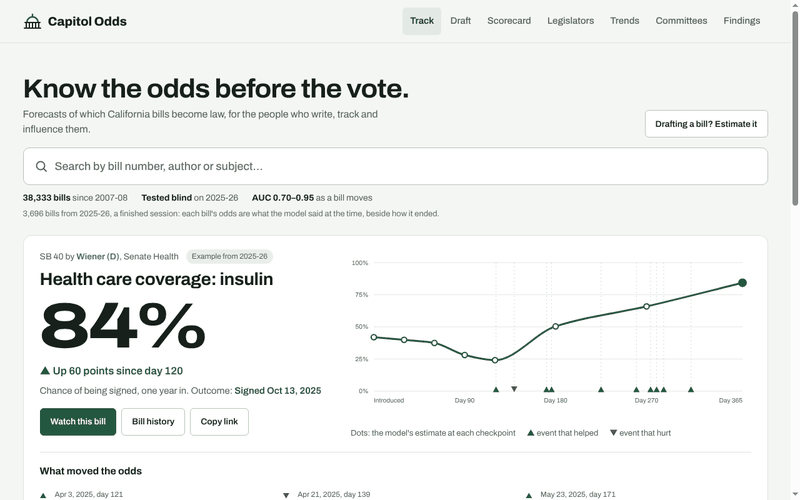
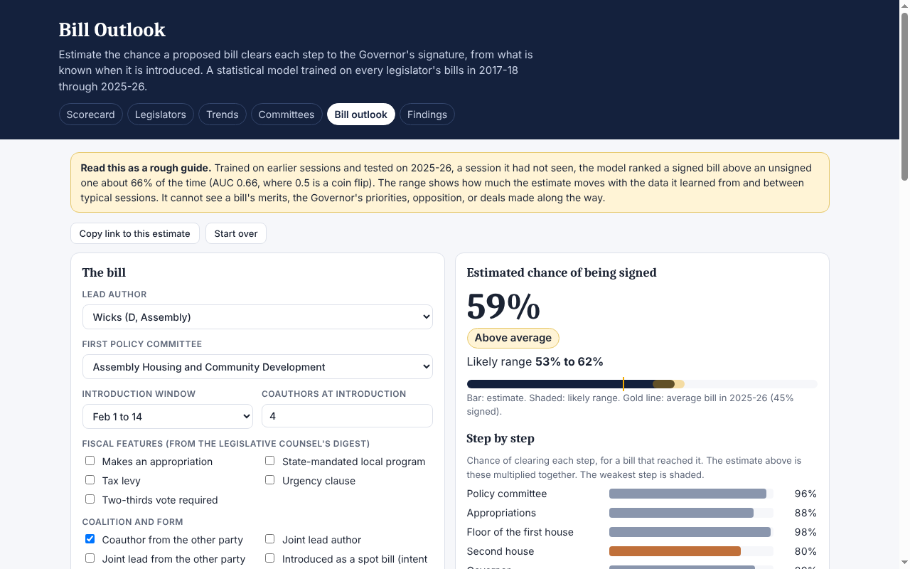
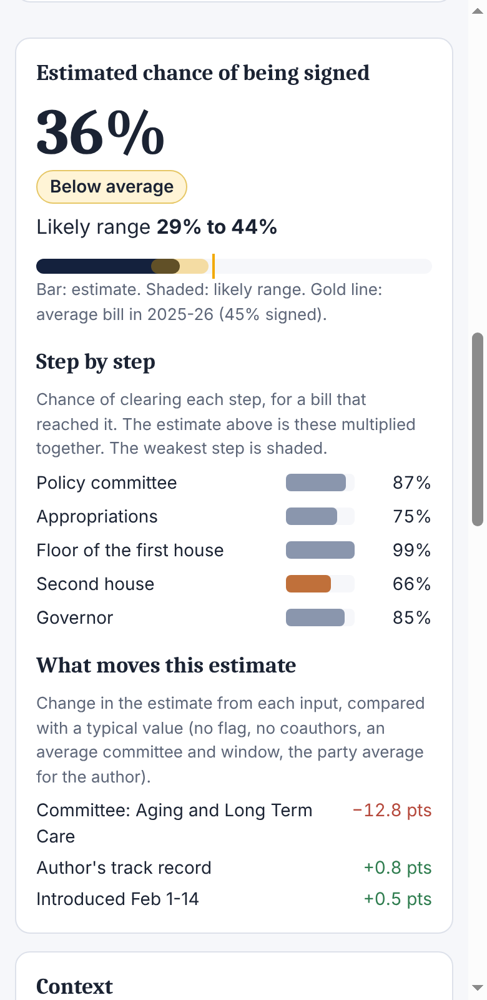

# California Legislative Scorecard

A transparent, reproducible scorecard for every member of the California Legislature since the 2017-18 session, rebuilt from the Legislature's official bulk data. One command downloads the data, parses it, applies documented counting rules and publishes a searchable dashboard. A weekly job refreshes it, reports what moved, and rolls over to each new session on its own.

**Dashboard:** https://jasontso2939.github.io/calleg-scorecard/



| Page | What it shows |
| --- | --- |
| [Scorecard](https://jasontso2939.github.io/calleg-scorecard/index.html) | Every member for any session: bills, signed, vetoed, rate, chamber ranks. Filters, sorting, per-member bill lists. |
| [Legislators](https://jasontso2939.github.io/calleg-scorecard/legislator.html) | One page per person: record by session with ranks, committee seats and votes by year, every bill. Name changes stay on one page. |
| [Trends](https://jasontso2939.github.io/calleg-scorecard/trends.html) | Where bills die, Appropriations by party, committee risk, fiscal flags, coauthors, timing, spot bills, veto reasons. |
| [Committees](https://jasontso2939.github.io/calleg-scorecard/committees.html) | Rosters by year, chairs and vice chairs with dates, each member's votes, from the official roll calls. Renamed committees keep one history. |
| [Bill outlook](https://jasontso2939.github.io/calleg-scorecard/outlook.html) | Chance a proposed bill clears each step (policy committee, Appropriations, floor, second house, Governor), with a likely range and similar past bills. |
| [Findings](https://jasontso2939.github.io/calleg-scorecard/findings.html) | Eight plain findings from ten years of bills, recomputed on every rebuild. |

Every page keeps its state in the URL, so any view can be shared, and every table has a CSV download. Pages load only the data they need (a legislator page is about 50 KB), so they work on a phone.

| Desktop | Phone |
| --- | --- |
|  |  |

## The idea

Most legislative rankings hide their counting decisions. Here each decision is a switch you can see:

- **Joint lead authors.** The official record credits every lead author. Bulk exports list only the first. Flip the toggle and watch rankings move.
- **Budget bills.** Budget Act bills are introduced under the budget chairs' names and would swamp their totals. They are excluded by default and can be included.
- **Time period.** Any session since 2017-18, whole session or one year at a time.
- **Partial terms.** Members who joined or left mid-session are flagged, with sources.

Every number comes from small tested functions, and every bill links to its official history. Hand-checked reference files cover what the export gets wrong or leaves out: seat changes, legislators whose listed names changed, renamed committees, and a 148-message read-through of veto messages that checks the veto-reason labels.

## Ten years at a glance (regular session, Assembly and Senate bills with a legislator author)

| Session | Bills | Signed | Vetoed |
| --- | --- | --- | --- |
| 2017-18 | 4,479 | 1,702 | 318 |
| 2019-20 | 4,576 | 1,103 | 228 |
| 2021-22 | 4,188 | 1,571 | 234 |
| 2023-24 | 4,522 | 1,771 | 344 |
| 2025-26 | 3,956 | 1,664 | 243 |

2019-20 is the outlier: the 2020 pandemic cut the calendar short. About 8% of bills have more than one lead author, which is why the counting method matters.

## Quick start

```bash
make setup       # virtualenv + dependencies
make fetch       # download the current session's export (~1.2 GB, logged in data/raw/MANIFEST.md)
make extract     # unpack the tables the pipeline reads
make archive     # finished sessions, ~34 MB from the session-archive branch
make build       # data/processed/*.csv
make site        # site/data/scorecard_<year>.js, one per session
make committees  # committee rosters, chairs and member votes from the roll calls
make people      # site/data/people/<slug>.js, one per legislator
make insights    # trends, the outlook model and the committee files
make test
make report      # what moved since the last commit
python3 -m http.server -d site   # open http://localhost:8000
```

## Keeping it current

`refresh.yml` runs every Monday. It downloads the session in progress, rebuilds everything, runs the tests, and writes a change report to the run summary and the commit message. If a headline number moves beyond a threshold (a finished session changes at all, the current session loses bills or its signed rate jumps more than 2 points, model accuracy shifts more than 0.02, a legislator's listed name changes) it opens an issue. Thresholds are at the top of `scripts/change_report.py`.

**Session rollover.** Nothing names a year except the first session covered. From December of an even year the job looks for the new session's download; once it appears, it becomes current, the previous session is packed into the archive branch, and the model keeps training only on finished sessions (outcomes are final on October 1 of the second year). This was tested end to end with a simulated 2027-28 session.

## Layout

| Path | What it is |
| --- | --- |
| `src/calleg/sessions.py` | Which sessions exist, which is current, which are finished |
| `src/calleg/pipeline.py` | Parses the official export into one row per bill and lead author; links people across sessions |
| `src/calleg/model.py` | The counting rules: `scorecard()` with `method` and `scope` arguments |
| `src/calleg/build.py` | One command from raw export to processed tables |
| `src/calleg/features.py` | One row per bill: committees, fiscal flags, coalition, timing, spot bills |
| `src/calleg/trends.py` | Statewide trend tables, including veto-reason classification |
| `src/calleg/committees.py` | Committee rosters, chairs and member votes from roll calls |
| `src/calleg/predict.py`, `stages.py` | Bill outlook: one-step and staged models, evaluation, ranges, export for the browser |
| `scripts/change_report.py` | Weekly change report and alerts |
| `data/reference/` | Hand-checked facts: seat changes, name changes, committee renames, veto review |
| `data/processed/` | Pipeline output (bills, members, committees, headline numbers) |
| `tests/` | Unit tests for the rules and data-quality checks on the full build |
| `site/` | Static dashboard, no build step, no dependencies |
| `docs/` | Methodology, data dictionary, committees, and the model (`MODEL.md`) |

## Limits, stated plainly

- Counts measure output, not the quality or importance of a bill.
- Success rate favors members who file fewer bills, so counts sit beside it.
- Resolutions and extraordinary-session bills are not scored.
- Veto reasons come from keyword rules that match a careful reading about 4 times in 5.
- The Legislature's export is the source of record. Spot-check any bill with its linked status page.

## Roadmap

1. Sessions before 2017 (the export goes back further).
2. Bill text and registered support and opposition as model inputs.
3. An MCP server so an AI assistant can answer questions about the data with source links.

## License and disclaimer

Code: MIT. The underlying legislative records are public. Not affiliated with any office or legislator.
