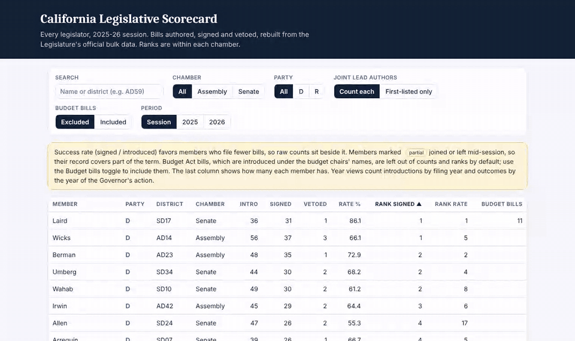
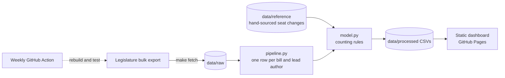

# California Legislative Scorecard

A transparent, reproducible scorecard for every member of the California Legislature, rebuilt from the Legislature's official bulk data. One command downloads the data, parses it, applies documented counting rules and publishes a searchable dashboard.

**[Open the live dashboard](https://jasontso2939.github.io/calleg-scorecard/)** · search every member, filter by chamber, open any member's bill list.



<!-- Walkthrough video: add the link here once it's recorded. -->

## The idea

Most legislative rankings hide their counting decisions. Here each decision is a switch you can see:

- **Joint lead authors.** The official record credits every lead author. Bulk exports list only the first. Flip the toggle and watch rankings move.
- **Budget bills.** Budget Act bills are introduced under the budget chairs' names and would swamp their totals. They are excluded by default and can be included.
- **Time period.** Whole session, or 2025 and 2026 separately.
- **Partial terms.** Members who joined or left mid-session are flagged, with sources.

Every number comes from small tested functions, and every bill links to its official history.

## How it works



The pipeline turns the official export into one row per bill and lead author. `scorecard()` in `model.py` applies the counting rules, with the method and time period as arguments, so the dashboard toggles and the tests exercise the same code.

## Decisions and tradeoffs

- **Toggles instead of one "correct" answer.** Reasonable people count joint authorship differently. Showing both methods side by side is more honest than picking one quietly.
- **Budget bills out by default.** Budget Act bills carry the budget chairs' names and would dominate their totals without saying anything about their own legislating.
- **Counts beside success rate.** Rate alone rewards members who file very few bills, so neither number is shown without the other.
- **Hand-sourced reference data where the export falls short.** Mid-session seat changes aren't in the bulk data, so they live in `data/reference/` with sources.
- **A static site with no build step.** The dashboard is one HTML file and one data file. Nothing to maintain, nothing to break, free to host.

## How it was built

Built with Claude Code. I designed the methodology, counting rules and data model, and directed and reviewed the implementation.

## 2025-26 at a glance (regular session, Assembly and Senate bills with a legislator author)

- 3,956 bills: 1,664 signed, 243 vetoed, 2,049 not enacted.
- About 8% of bills have more than one lead author, which is why the counting method matters.

## Quick start

```bash
make setup     # virtualenv + dependencies
make fetch     # download the 2025-26 session export (~1.2 GB, logged in data/raw/MANIFEST.md)
make extract   # unpack the tables the pipeline reads
make build     # data/processed/*.csv
make site      # site/data.js for the dashboard
make test
python3 -m http.server -d site   # open http://localhost:8000
```

A weekly GitHub Action (`refresh.yml`) rebuilds everything from fresh data.

## Layout

| Path | What it is |
| --- | --- |
| `src/calleg/pipeline.py` | Parses the official export into one row per bill and lead author |
| `src/calleg/model.py` | The counting rules: `scorecard()` with `method` and `scope` arguments |
| `src/calleg/build.py` | One command from raw export to processed tables |
| `data/reference/` | Hand-sourced facts the export lacks (mid-session seat changes) |
| `data/processed/` | Pipeline output (bills, members, scorecards) |
| `tests/` | Unit tests for the rules and data-quality checks on the full build |
| `site/` | Static dashboard, no build step, no dependencies |
| `docs/` | Methodology and data dictionary |

## Limits, stated plainly

- Counts measure output, not the quality or importance of a bill.
- Success rate favors members who file fewer bills, so counts sit beside it.
- Resolutions and extraordinary-session bills are not scored.
- The Legislature's export is the source of record. Spot-check any bill with its linked status page.

## Roadmap

1. Have the weekly refresh publish to the live dashboard (today it rebuilds and tests the data, then stores it as a workflow artifact).
2. Classify veto messages by reason across sessions.
3. An MCP server so an AI assistant can answer questions about the data with source links.
4. Earlier sessions for trends.

## License and disclaimer

Code: MIT. The underlying legislative records are public. Not affiliated with any office or legislator.
